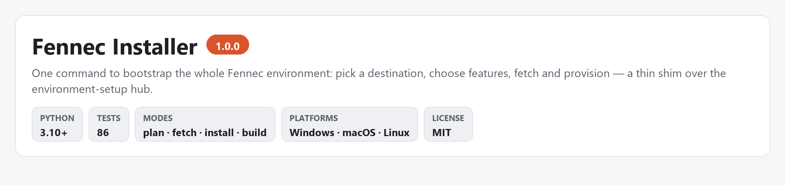

---

## At a glance

| Tests | Entry scripts | Exclusive modes | Layout dirs | Features (hub manifest) |
|:---:|:---:|:---:|:---:|:---:|
| 86 in 4 files | 4 | 3 (+ `--build` / `--update`) | 5 | 10 |

Counts from `tests/`, the four scripts with a `__main__` entry and the hub's `repos.json`.
Device detection, dependency installation, engine builds and checkout updates all live in the
[hub](https://github.com/Liso7150/fennec-environment-setup) — not here. `updater.py` is the
fourth: `python updater.py` checks GitHub releases for this repo (`--experimental` polls the
`main` branch instead). The published `v0.x` tags carry no assets, so on this repo it currently
reports nothing to fetch.

## Flow

```
 python install.py / bootstrap.py
      │
      ├─ pick destination ──► interactive picker, --root <path> or --drive <letter>
      ├─ bootstrap hub ─────► clone / verify Liso7150/fennec-environment-setup (main only)
      ├─ choose features ───► menu, --features … or --all (dependency closure)
      └─ hand off to hub ───► plan ─► fetch ─► install ─► ~/.fennec/config.json
                            read-only   sources   deps + optional cargo build
```

The installer never starts a server. Models are not downloaded by default; only explicit
`--download-model` during `--install` fetches the recommended model. Only public GitHub
sources are fetched otherwise; nothing is uploaded.

## Prerequisites

| Requirement | Needed for |
|---|---|
| Python 3.10+ on PATH | everything |
| Git | cloning the hub and the suite |
| Rust (`cargo`) | `--build` only |

Nothing is installed system-wide and no PATH entry is changed permanently.

## Run

```bash
python install.py                                          # interactive menu
python install.py --features inference,desktop --yes        # fetch sources only
python install.py --all --yes                               # fetch everything
python install.py --update --yes                            # update installed checkouts
python install.py --install --features inference,desktop --yes
python install.py --install --features inference --build --yes
python install.py --install --features inference --download-model --yes
python install.py --features browser-outlets --yes          # clone OpenBot, fill Fennec's own browser env
python bootstrap.py --plan --all                            # read-only plan
```

`install.py` is the compatibility entry point: with no explicit mode it selects
`--fetch-only`, preserving the historical "download the repos" behavior. `--plan`,
`--fetch-only`, `--install` and `--build` always win.

> [!IMPORTANT]
> `--yes` confirms an explicit action but never *selects* features. Noninteractive runs must
> pass `--features` or `--all` (or `--update` for installed checkouts).

### Modes

| Flag | Effect |
|---|---|
| `--plan` / `--dry-run` | print the plan; no mutation, no network |
| `--fetch-only` | clone or verify checkouts (the `install.py` default) |
| `--install` | fetch, then provision dependencies and write the config |
| `--build` | additionally `cargo build --release` the engine (implies `--install`) |
| `--update` | `git pull --ff-only` on installed clean checkouts, including the engine checkout (`ROOT/engine`, [Liso7150/fennec](https://github.com/Liso7150/fennec)) |
| `--json` | machine-readable output (`--plan` only) |

`--plan`, `--fetch-only` and `--install` are mutually exclusive; `--build` cannot be
combined with `--fetch-only`. Installing provisions `python` on PATH and writes
`~/.fennec/config.json` **only after every action succeeds**.

### Recommended model

Interactive installs that select core offer the recommended model before running actions;
`--download-model` is the explicit noninteractive opt-in. Both download
`Liso/qwen36-35b-colibri` (the Fennec-ready int4 container, up to **22.78 GiB**) only during `--install`, require a selected core
checkout, install `fennec-core[models]`, and call the existing
`setup_wizard.download_recommended_model` helper with the configured Python. The planned
config and engine command use `<models_root>/qwen36-35b`.

`--plan` and `--fetch-only` show the action but never run it. `--model` still selects an
existing local model without downloading; combining it with `--download-model` is refused
unless both name `<models_root>/qwen36-35b`.

### Overrides

| Kind | Flags |
|---|---|
| Roots | `--root`, `--drive`, `--setup-home`, `--engine-root`, `--suite-root`, `--models-root`, `--cache-root` |
| Config | `--python`, `--model`, `--engine-url`, `--web-root`, `--workspace`, `--backend`, `--policy`, `--ctx`, `--openbot-url`, `--web-python` |
| Manifest | `--manifest`, `--config` |

`--drive` and `--root` are alternatives; pass only one.

## Install destination

On an interactive run the installer lists the drives it finds with their free space, offers
the default (`~/Fennec`), accepts any drive letter or folder, then shows the layout before
anything is downloaded:

```
ROOT/engine   Fennec engine checkout (Rust; cargo build --release)
ROOT/suite    suite sources: desktop, core, CLI, plugins, fine-tuning, optional outlets
ROOT/models   model weights (optional --download-model)
ROOT/cache    pip / Hugging Face caches
ROOT/setup    environment setup hub used by this installer
```

`--yes` keeps the default roots (`~/Fennec`, `~/Fennec-Suite`, `~/fennec-models`,
`~/.cache/fennec` on a fresh machine) or any roots passed explicitly. Fennec is the only
engine: a leftover `~/Colibri` checkout is never chosen as an engine root, and a config
that names one is migrated to the Fennec default. The shared config
`~/.fennec/config.json` is the one small file written outside the chosen root, because
every Fennec app reads it.

`--build` runs `cargo build --release` in `ROOT/engine`, `cargo build --release` for the
CLI and the coding-agent backend, and `cargo build --release --features gui --bin
fennec-desktop-gui` for the desktop; the plan reports a missing `cargo` as a requirement.
The resulting `target/release/fennec(.exe)` is launched directly, with no Python in front
of it. On Windows the release GPUI window additionally needs `fxc.exe` from the Windows
SDK; without it, build the debug window (`cargo build --features gui`).

## Device detection

The hub probes NVIDIA (`nvidia-smi`), Vulkan, Metal (macOS), Intel NPU (OpenVINO), RAM and
free disk, then recommends a config. The recommendation is deliberately conservative: CPU
decoding at `policy=balanced` with a context window sized to the machine (for example an
8 GB GPU + 16 GB RAM → `ctx=4096`).

> [!NOTE]
> Seeing a GPU is not proof that a native accelerator backend was compiled, so the plan
> keeps CPU until you verify an engine build and switch `backend` yourself. The Intel NPU is
> an **embedding sidecar only**, never a decoder.

Selecting the `npu` feature installs the sidecar's imports (`openvino`,
`openvino-tokenizers`, `numpy`, `huggingface-hub`) and fetches the prebuilt OpenVINO IR
embedding model (`OpenVINO/bge-base-en-v1.5-int8-ov`) into
`<models_root>/embed/bge-base-en-v1.5-int8-ov`. Nothing exports the model itself: the plan
never installs `optimum-intel`, so torch and nncf stay out of that interpreter. Everything
is cached under `<cache_root>` and only runs in `--install` mode after you allow downloads.

## Browser outlets

`browser-outlets` clones [OpenBot](https://github.com/CopilotKit/OpenBot) beside the suite and
stops there: no dependencies installed, no patches, nothing started. `--openbot-url` points at a
workspace you already run.

`web_task` needs no checkout — it is Fennec's own loop, which asks a Liquid **d1** model one
question per step, so it wants an endpoint to ask: a `LIQUID_API_KEY` for the hosted `d1.2`, or a
`LIQUID_ENDPOINT` for the free local `d1-2B` — plus an interpreter that can import
`browser_harness.helpers`. This feature installs that interpreter as a venv of the lane's own at
`~/.fennec/browser-tools/fennec/.venv` with the pinned transport in it, never in the interpreter
the apps run on. `--web-python` pins a different one.

## Platform support

| Platform | What runs |
|---|---|
| Windows / macOS / Linux | the installer directly, engine on device |
| Android, Termux | core + PWA locally via the `mobile` feature (see [`android/`](android/README.md)) |
| Android browser / iOS | PWA client of a Fennec host; on-device engine installation is refused |

Termux is treated as a local Linux userspace: the engine starts on demand there when a
compatible small model and ARM build exist. A 35B model is never expected to run on a phone.
There is **no APK build pipeline** — `android/webview/` is a scaffold, and the Android SDK
and Gradle are not shipped.

## Migrating an existing Colibri install

`migrate_rebrand.py` moves a machine still on the Colibri names onto the Fennec names in
one pass: the suite/hub/models folders, `<root>/.cache/colibri-*`, `~/.colibri` →
`~/.fennec`, `~/.colibri-code` → `~/.fennec-desktop`, the roots inside `config.json`, the
legacy `acp.registry.colibri` records in Air's overlay and `installed.json`, the `Colibri`
picker entry, the `air.acp.registry.path` vmoption, and the model path in the engine's
local stack scripts.

```bash
python migrate_rebrand.py            # print the plan, change nothing
python migrate_rebrand.py --apply    # perform it
```

It is idempotent and stops at the first locked folder without rewriting any config, so a
failed run is safe to repeat. Every edited file keeps a `*.bak-fennec-rebrand` backup beside
it. The engine checkout is deliberately untouched — a legacy Colibri root is carried
through the rename like any other folder and is never launched afterwards; Fennec is the
only engine the suite runs. The stale desktop code index is retired rather than rewritten
so the sidecar rebuilds it.

> [!WARNING]
> Close Qoder and every JetBrains IDE first: Windows refuses to rename a directory while a
> process holds a file inside it open. On Windows, copy `migrate-fennec.bat` **outside** the
> suite (a drive root or `%USERPROFILE%` works) and run that — `cmd.exe` keeps a handle on
> the running batch file, and the copy also stages the Python script in `%TEMP%`.

Afterwards, install the desktop app and the IDE plugin for the version you are on and start
the IDE once so it republishes the Fennec Air card. The newest published installers are the
`v0.9.0` pair, `FennecDesktop-0.9.0-x64.exe` and `Fennec-plugin-0.9.0.zip`, and that release
note calls itself the **last Electron build**. The native Rust app that replaced it has no
published release and no installer wrapper, so build it yourself: the plugin zip via
[`fennec-jetbrains/build-plugin.sh`](https://github.com/Liso7150/fennec-jetbrains), the desktop
app via `cargo build --release --offline` in
[`fennec-desktop`](https://github.com/Liso7150/fennec-desktop) (the gpui-kit binary, needs
`fennec-core` beside it as a path dependency).

## Tests

```bash
python -m unittest discover -s tests -v     # 86 checks across 4 files
```

Hermetic: temporary directories and mocks, no network client calls, no downloads, no
servers. A few bootstrap tests exercise real local `git init` / `remote add` in a temp
directory and skip when git is absent; none of them fetch.

## Credits

Engine: [Liso7150/fennec](https://github.com/Liso7150/fennec) — one native Rust engine
(`serve` / `run` / `info` / `plan` / `doctor`, OpenAI-compatible HTTP on `127.0.0.1:8184`).
Base idea: [JustVugg/colibri](https://github.com/JustVugg/colibri) — device-tiered MoE
inference (historical credit only; no Colibri checkout is launched, built or fetched).
Fine-tuning:
[AirLLM](https://github.com/lyogavin/airllm). Coworker outlet:
[CopilotKit/OpenBot](https://github.com/CopilotKit/OpenBot), used exactly as upstream and never
modified or vendored. Browser policy: Liquid
[d1](https://api.liquid.ai/decisions/v1/systemone) family — the hosted `d1.2`, a paid API the
core calls over HTTPS, or the free open-weight `d1-2B` answered by a System One-compatible
model server on loopback — the hosted half needs only a key, the loopback half needs that
server to already be running (Fennec's own engine serves `/v1/chat/completions`, not
`/v1/systemone`); nothing is cloned or installed for either by the installer. Browser transport:
[browser-harness](https://github.com/browser-use/browser-harness), the CDP driver
`browser-outlets` pip-installs into Fennec's own browser venv. Part of the
[Fennec suite](https://github.com/Liso7150/fennec-environment-setup).
